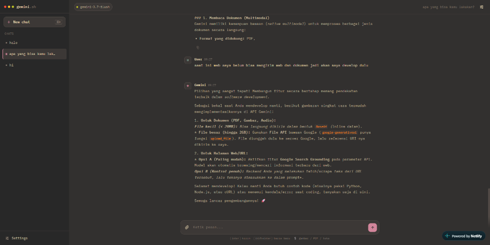

# gemini.sh

Klien chat berbasis web untuk Google Gemini API, dengan tampilan terminal ala Catppuccin Mocha. Dibangun murni dengan HTML, CSS, dan JavaScript (ES Modules) — tanpa framework atau proses build.

<p align="center">
  
</p>

## Fitur

- Chat streaming langsung ke Gemini **Interactions API** (`POST /v1beta/interactions`, `stream: true`) dari browser
- Riwayat percakapan (buat, pilih, hapus) tersimpan otomatis
- Model tunggal (`gemini-3.7-flash`, di-hardcode di `js/state.js` — tanpa dropdown pilihan model)
- Nama tampilan bisa diganti sendiri lewat Settings (tersimpan lokal, bukan akun/login sungguhan)
- 3 tema (Mocha, Nord, Gruvbox) — warna & font berubah, dipilih dan diterapkan langsung lewat Settings
- Upload lampiran ke chat: gambar (dikompres otomatis di browser sebelum dikirim), PDF, dan file teks/kode (dibaca sebagai teks) — dikirim ke Gemini sebagai input multimodal
- Optimisasi: update tampilan saat streaming di-throttle per animation frame, scroll listener `passive`, gambar lampiran lazy-loaded, peringatan otomatis kalau penyimpanan browser penuh
- Render Markdown ringan: bold, italic, inline code, code block dengan tombol copy, list, dan link
- Regenerate respons terakhir & stop generating di tengah stream
- Copy pesan, auto-resize input, auto-scroll, dan sidebar responsif (mobile-friendly)
- API key Gemini dikirim langsung ke Google — tidak lewat server perantara

## Struktur proyek

```
gemini-sh/
├── index.html          # Shell HTML
├── css/                # Stylesheet per komponen (di-import lewat main.css)
└── js/                 # ES Modules per tanggung jawab (state, dom, render, api, dst.)
```

## Menjalankan secara lokal

Karena `index.html` memuat `js/main.js` sebagai ES Module, file **tidak bisa** dibuka langsung lewat `file://` (akan diblokir CORS oleh browser). Jalankan lewat server statis, misalnya:

```bash
# opsi 1: pakai Node
npx serve .

# opsi 2: pakai Python
python3 -m http.server 8080
```

Lalu buka `http://localhost:<port>` di browser.

## Setup

1. Buka aplikasi, klik **Settings**.
2. Ambil API key gratis di [aistudio.google.com/app/apikey](https://aistudio.google.com/app/apikey).
3. Tempel key, klik **Save**.

## Catatan

- Data (chat & API key) disimpan di `localStorage` browser — tersimpan per browser/perangkat, tidak sinkron antar perangkat, dan hilang kalau kamu clear browser data.
- API key Gemini dikirim langsung dari browser ke Google (client-side), jadi **jangan deploy di situs publik yang bisa diakses banyak orang tanpa proteksi tambahan** kalau kamu keberatan orang lain berpotensi melihat trafik jaringan berisi key tersebut.
- App ini memakai Gemini **Interactions API** (bukan `generateContent`/`streamGenerateContent` lama). Riwayat percakapan dikirim ulang penuh di tiap request (`store: false`) supaya cocok dengan cara app ini menyimpan history secara lokal. Model dikunci ke satu nilai di `export const MODEL` (`js/state.js`) — kalau Google mengganti/mendeprecate nama model itu, cukup ubah nilai konstanta ini.
- Lampiran (gambar/PDF/teks) ikut disimpan dalam riwayat chat di `localStorage`, sebagai base64. Ini boros ruang — kuota `localStorage` browser biasanya cuma 5–10MB per situs, jadi chat dengan banyak gambar bisa cepat penuh. Gambar sudah dikompres otomatis (maks ~1568px, JPEG kualitas 82%) untuk menghemat sedikit, tapi kalau kamu butuh riwayat chat besar dengan banyak lampiran secara reguler, pertimbangkan migrasi penyimpanan ke backend/cloud storage.

## Tech stack

- Vanilla JavaScript (ES Modules)
- CSS custom properties (tema Catppuccin Mocha)
- Font: JetBrains Mono
- Google Gemini API (REST, streaming SSE)
